# Event Radar Operations Guide (운영 및 장애 복구 가이드)

Event Radar 시스템의 정기 배치 운영, 수동 일정 추가, Collector 확장, 장애 복구 및 Google Drive 연동 매뉴얼입니다.

---

## 1. 정기 배치 운영

### 1.1 GitHub Actions 스케줄
- **한국시간 06:00 (UTC 21:00)**: 국내 증시 개장 전 신규 공시 및 미국 장마감 실적/이벤트 수집
- **한국시간 18:00 (UTC 09:00)**: 국내 증시 정규장 마감 후 공시 및 미국 증시 프리마켓 일정 수집
- **수동 실행**: GitHub 저장소 `Actions` 탭 → `Scheduled Event Collection` 선택 → `Run workflow`

### 1.2 배포 흐름

```mermaid
flowchart LR
    A[Cron / Manual Trigger] --> B[scripts/collect.py]
    B --> C[Canonical CSV Merge]
    C --> D[Backtest & Score Engine]
    D --> E[Export site/data/*.json]
    E --> F[scripts/backup_drive.py]
    F --> G[git commit & push]
    G --> H[deploy-pages.yml]
    H --> I[GitHub Pages Live]
```


---

## 2. 수동 일정 및 관련주 관리 (Google Form / Sheet)

### 2.1 수동 입력 원칙
1. 공개 대시보드(GitHub Pages)는 정적 읽기 전용으로 운영됩니다.
2. 운영자는 Google Form(또는 Google Sheet)을 통해 수동 일정을 등록합니다.
3. 수동 데이터는 `ingest_mode = "MANUAL"`로 기록되며, **자동 수집 파이프라인이 절대로 임의 덮어쓰지 않습니다.**
4. 만약 자동 규제기관(DART/SEC)에서 수동 데이터와 다른 날짜를 공식 발표한 경우:
   - 수동 값은 유지되며,
   - 해당 이벤트의 `needs_review = true` 플래그가 설정되어 대시보드 검토 대상이 됩니다.

### 2.2 수동 파일 로컬 반영
- 수동 일정: `data/canonical/manual_events.csv`에 직접 행 추가 또는 Sheet 동기화
- 수동 관련주: `data/canonical/manual_relations.csv`에 직접 행 추가
- 반영 후 재집계:
  ```bash
  python scripts/rebuild_backtest.py
  ```

---

## 3. 장애 처리 및 Graceful Degradation

### 3.1 특정 Collector 장애 발생 시
- 예: DART API 일시 점검 또는 특정 웹사이트 HTML 구조 변경
- **시스템 동작**:
  1. 실패한 Collector는 `data/logs/collector_runs.csv`에 `FAILED` 및 에러 메시지를 기록합니다.
  2. 파이프라인은 중단되지 않고 다음 Collector를 계속 실행합니다.
  3. 기존 수집된 canonical 데이터는 그대로 유지되며, 백테스트와 Pages 배포가 성공적으로 완료됩니다.
  4. 메인 화면 `metadata.json`의 `collector_status`에 소스별 상태가 노출됩니다.

### 3.2 HTML 구조 변경 시 대응
`config/site_registry.yaml`의 selector나 regex를 수정하기만 하면 코드 배포 없이 수집 로직이 정상화됩니다.
```yaml
sources:
  games_kr:
    container_selector: ".new-game-container"  # 변경된 선택자로 수정
    title_selector: ".new-game-title"
```

---

## 4. Google Drive 백업 설정 및 복구

### 4.1 필요한 GitHub Secrets
- `GOOGLE_CLIENT_ID`: Google Cloud OAuth 클라이언트 ID
- `GOOGLE_CLIENT_SECRET`: Google Cloud OAuth 클라이언트 시크릿
- `GOOGLE_REFRESH_TOKEN`: 오프라인 접근용 Refresh Token
- `GOOGLE_DRIVE_FOLDER_ID`: 백업 파일이 저장될 구글 드라이브 폴더의 고유 ID

### 4.2 최초 토큰 발급 (Bootstrap)
로컬 터미널에서 다음 스크립트를 1회 실행하여 가이드를 따릅니다:
```bash
python scripts/oauth_bootstrap.py
```

### 4.3 백업 실패 시 영향
Google Drive 백업 실패는 **Non-fatal warning**으로 처리되어 GitHub Actions 및 Pages 배포가 실패하지 않습니다.

---

## 5. 로컬 개발 및 테스트 명령어

```bash
# 가상환경 활성화 (Windows)
.\.venv\Scripts\Activate.ps1

# 전체 테스트 실행
pytest -p no:cacheprovider -v

# 수집 파이프라인 수동 1회 실행
python scripts/collect.py

# 정적 사이트 로컬 미리보기
cd site
python -m http.server 8080
# 브라우저에서 http://localhost:8080 접속
```
